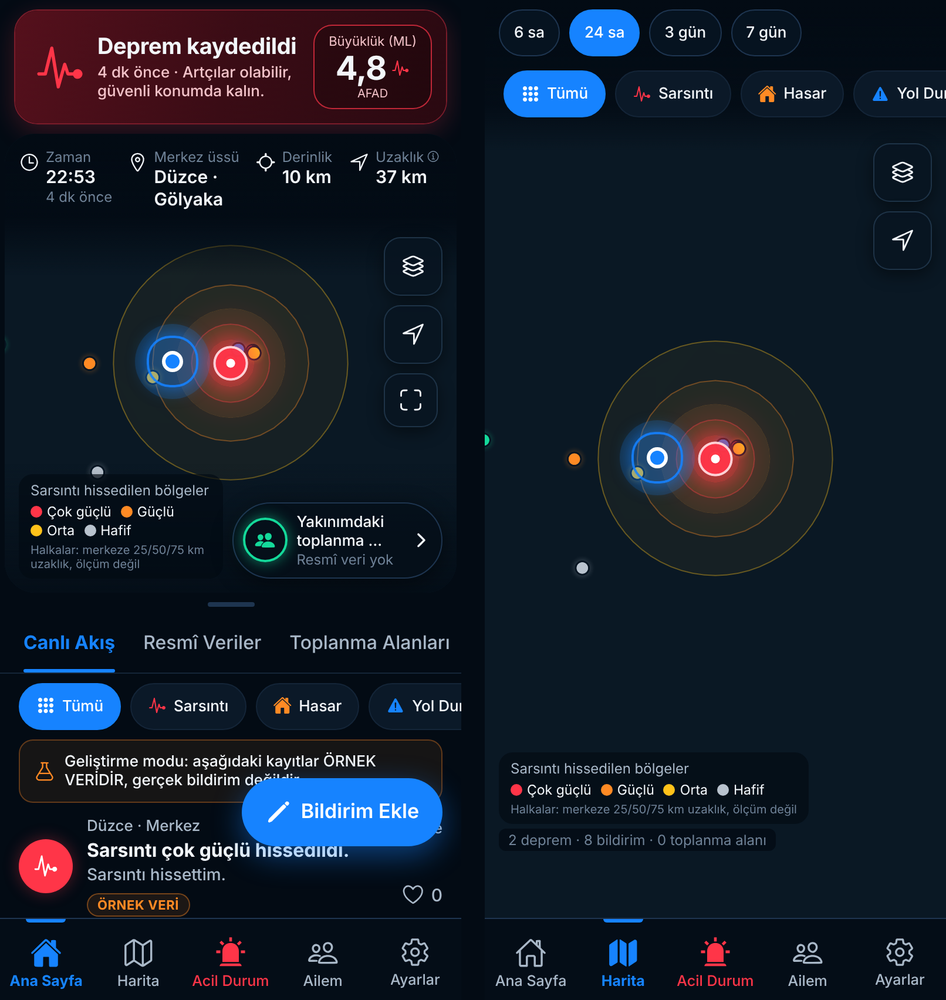

# GÜVENDE — Deprem ve Afet Güvenliği Uygulaması

React Native (Expo SDK 58, Expo Router, TypeScript) ile iOS ve Android için geliştirilen mobil uygulama.
Backend: Supabase (Postgres + RLS + Storage + Edge Functions). Harita: MapLibre React Native.

> Projenin güncel durumu, doğrulanan/doğrulanamayan noktalar: [`docs/TEKNIK_DURUM.md`](docs/TEKNIK_DURUM.md)


_(Web önizlemesi: kaplama katmanları gerçek çizimdir, taban harita karoları bu ortamdan yüklenemediği için zemin düzdür. Deprem kaydı test verisidir; akıştaki kayıtlar “ÖRNEK VERİ” etiketlidir.)_

## Windows'ta kurulum

1. [Node.js 22 LTS](https://nodejs.org) ve [Git](https://git-scm.com) kurun.
2. Bağımlılıklar:
   ```powershell
   npm install
   copy .env.example .env   # değerleri doldurun
   ```
3. **Development build gerekir** (MapLibre yerel modül içerdiği için Expo Go ile çalışmaz):
   - **Android (Windows'ta yerel):** Android Studio + bir emülatör veya USB hata ayıklamalı telefon →
     `npx expo run:android`
   - **iOS (Windows'tan bulutta):** `npx eas-cli@latest build --profile development --platform ios`
     (Apple Developer hesabı gerekir), sonra `npm run start:dev-client`.
   - Bulutta Android: `npx eas-cli@latest build --profile development --platform android`
4. Push bildirimleri için bir kez `npx eas-cli@latest init` çalıştırın (EAS `projectId` oluşturur).

## iPhone'da hızlı deneme (Expo Go, Apple hesabı gerekmez)

1. iPhone'a App Store'dan **Expo Go** uygulamasını kurun (güncel sürüm; SDK 58).
2. Bilgisayarda proje klasöründe: `git pull`, `npm install`, ardından **`npm run iphone`**
   (`expo start --tunnel --go --clear`: Expo Go modu, tünel, temiz önbellek).
3. **Expo Go uygulamasını** açın: *Scan QR code* ile okutun ya da *Enter URL manually* kısmına terminaldeki
   `exp://…` adresini yazın. (iPhone Kamera'sı "Kullanılabilir veri bulunamadı" derse Expo Go içinden okutun.)
4. Telefon ve bilgisayar aynı anda açık kalmalı; terminali kapatmayın.

Expo Go yerel harita modülünü (MapLibre) içermez; bu modda uygulama gömülü Türkiye altlığıyla çizilen
**basit harita** kullanır (uydu/sokak ayrıntısı yok). Tam harita için geliştirme derlemesi gerekir
(`eas build --profile development --platform ios`, Apple Developer hesabı ister).

## Ortam değişkenleri (`.env`)

| Değişken | Açıklama |
| --- | --- |
| `EXPO_PUBLIC_SUPABASE_URL`, `EXPO_PUBLIC_SUPABASE_ANON_KEY` | Yalnızca herkese açık anon anahtar. **service_role anahtarı asla buraya yazılmaz.** |
| `EXPO_PUBLIC_MAP_STYLE_URL` | MapLibre stil URL'si. Boşsa OpenFreeMap `dark` (anahtarsız). |
| `EXPO_PUBLIC_QUAKE_SOURCES` | `afad,kandilli,usgs` |
| `EXPO_PUBLIC_DEMO_REPORTS` | `1` ise yalnızca geliştirme derlemesinde, backend yokken “ÖRNEK VERİ” etiketli örnek akış. Üretimde yok sayılır. |

## Supabase kurulumu

```bash
npx supabase link --project-ref <proje>
node scripts/sync-function-shared.mjs      # fonksiyonların kullandığı src/ kodunu kopyalar
npx supabase db push                       # supabase/migrations/*
npx supabase functions deploy ingest-earthquakes delete-account notify-family verify-identity
```

- **Gizli değerler:** `20261023000007_jobs.sql` Vault'ta rastgele `ingest_secret`, `webhook_secret`, `identity_hash_pepper` üretir; fonksiyonlar bunları `internal_secret` (yalnızca service_role) ile okur. Panelde elle secret girmek gerekmez (girilirse ortam değişkeni önceliklidir). Push için isteğe bağlı: `EXPO_ACCESS_TOKEN`.
- **Proje adresi (bir kez, SQL düzenleyicide):** `select vault.create_secret('https://<proje>.supabase.co', 'project_url');`
- **Auth:** E-posta girişi varsayılan "Sign in" bağlantısıyla çalışır (özel SMTP olmadan şablon düzenlenemez). Bağlantıya dokununca uygulamaya dönmesi için *Authentication → URL Configuration → Redirect URLs*'e `guvende://**` ve (Expo Go için) `exp://**` ekleyin; eklenmezse kullanıcı bağlantıyı kopyalayıp uygulamaya yapıştırır.
- **ingest-earthquakes:** `pg_cron` **2 dakikada bir** `pg_net` ile `x-ingest-secret` başlığıyla çağırır (migration kurar). Kaynakların kullanım koşulları yazılı olarak doğrulanmadığı için 1 dk yerine 2 dk seçildi.
- **notify-family:** `safety_checkins` INSERT tetikleyicisi `x-webhook-secret` ile çağırır (migration kurar; konum gönderilmez).
- **verify-identity (kimlik doğrulama):** NVİ KPSPublic servisine bağlanır; Vault'taki `identity_hash_pepper` (veya `IDENTITY_HASH_PEPPER`) olmadan çalışmaz. T.C. no / ad / doğum yılı saklanmaz.
- **Kurumsal hesap (Resmî rozet):** Yalnızca SQL düzenleyicisinden (service role) atanır:
  `update public.profiles set role = 'official', org_name = 'AFAD Düzce' where id = '<kullanıcı-uuid>';` (kurtarma ekibi için `role = 'rescue'`).
- **Toplanma alanları:** `scripts/import-assembly-points.mjs` ile yalnızca resmî kaynak dosyalarından (varsayılan kuru çalıştırma).

### Deprem veri akışı

```
AFAD · Kandilli · EMSC · USGS ──(yalnızca sunucu, 2 dk)──▶ ingest-earthquakes ──▶ earthquake_readings + quake_sync_state
                                                                    │                         │ (Realtime)
                                                                    └─▶ push (Expo)          ▼
                                                                                     Mobil uygulama (okur)
```

- **Cihazlar kaynakları sürekli sorgulamaz.** Uygulama `earthquake_readings`'i okur, Realtime ile yeni/değişen kayıtları alır ve 5 dk'da bir yalnızca GÜVENDE sunucusunu yeniden okur. Kaynaklar cihazdan doğrudan yalnızca sunucu yapılandırılmamışsa veya sunucuya ulaşılamadığında (tek deneme) sorgulanır.
- **Artımlı senkron:** her kaynak için son başarılı çekimden 2 saat geriye (örtüşme; kaynak revizyonları için), en fazla 24 saat. Yalnızca yeni veya değişmiş okumalar yazılır; aynı kaynak+olay kimliği birincil anahtar olduğundan tekrar eklenmez, değişen değerler güncellenir (`updated_at`).
- **Hata yönetimi:** istek başına 15 sn zaman aşımı, ağ/429/5xx için 3 deneme (1 sn, 3 sn), ardışık hatalarda kaynak 1→2→4…60 dk ertelenir. Hata durumunda eski veriler silinmez.
- **Durum ayrımı (`quake_sync_state`):** `last_attempt_at` (son deneme), `last_success_at` (son başarılı çekim), `last_event_at` (kaynaktaki en yeni olay), `status` (`ok`/`error`/`schema_changed`), `last_error`. `sample_keys` gerçek yanıttaki alan adlarını tutar; beklenen alanlar kaybolursa durum `schema_changed` olur.
- **Eskime:** son başarılı senkron 10 dakikadan eskiyse uygulama verinin güncel olmadığını açıkça yazar.
- **Push:** yeni olay (son 30 dk, M≥3) için tercihlere (açık/kapalı, eşik, bölge yarıçapı, en kısa aralık, ülke geneli M5+) göre; `notified_events` ile her olay bir kez. İçerik: büyüklük, yer, olay saati (TSİ), kaynak. Expo'nun `DeviceNotRegistered` dediği belirteçler silinir. "accepted" = Expo'nun kabul ettiği mesajdır; teslim veya okunma anlamına gelmez.
- **Erken uyarı yoktur.** Tüm bildirimler gerçekleşmiş deprem kayıtlarıdır; doğrulanmış bir erken uyarı sağlayıcısı entegre değildir.

### Migration'lar

| Dosya | İçerik |
| --- | --- |
| `…01_init` | Temel şema, RLS |
| `…02_storage` | Fotoğraf deposu |
| `…03_push_dispatch` | Bildirim tekrar önleme |
| `…04_prefs_feedback` | Bildirim tercihleri, geri bildirim |
| `…05_trust` | Kimlik, konum/foto kuralları, topluluk oyları (3 onay), ihlal/askı |
| `…06_harden_grants` | Fonksiyon yetkilerinin daraltılması |
| `…07_jobs` | Vault gizli değerleri, cron, aile push tetikleyicisi |
| `…08_readonly_public_tables` | Deprem/toplanma tablolarına istemci yazamaz |
| `…09_emsc_source` | EMSC kaynağı |
| `…10_quake_sync` | Senkron durumu, değişiklik zamanları, Realtime yayını, 2 dk cron |
| `…11_vote_anti_collusion` | Kimliği <24 sa olan hesap oy veremez; aynı yazara 24 sa'te en fazla 3 onay |

### Ortam değişkenleri (adlar; değerler kaynak koda yazılmaz)

- İstemci: `EXPO_PUBLIC_SUPABASE_URL`, `EXPO_PUBLIC_SUPABASE_ANON_KEY` (herkese açık anon anahtar), `EXPO_PUBLIC_MAP_STYLE_URL`, `EXPO_PUBLIC_QUAKE_SOURCES`, `EXPO_PUBLIC_DEMO_REPORTS`.
- Sunucu (Supabase otomatik verir): `SUPABASE_URL`, `SUPABASE_SERVICE_ROLE_KEY` — yalnızca Edge Function ortamında.
- Sunucu (isteğe bağlı; yoksa Vault kullanılır): `INGEST_SECRET`, `WEBHOOK_SECRET`, `IDENTITY_HASH_PEPPER`, `EXPO_ACCESS_TOKEN`.

## Komutlar

| Komut | Ne yapar |
| --- | --- |
| `npm test` | Jest birim + bileşen testleri |
| `npm run typecheck` | TypeScript denetimi |
| `npm run test:db` | Yerel PostgreSQL 16+ ile şema + RLS testleri (Linux/WSL; Windows'ta WSL önerilir) |
| `npx deno test supabase/functions/_shared/` | Sunucu işlevi birim testleri (`supabase/functions` dizininde) |

## Klasör yapısı

```
src/app/                 Expo Router ekranları ((tabs): Ana Sayfa, Harita, Acil Durum, Ailem, Ayarlar)
src/features/earthquakes Kaynak katmanı (AFAD, Kandilli, USGS), birleştirme, uyarı durumu, bileşenler
src/features/map         MapLibre haritası, katmanlar, lejant, seçim kartı
src/features/reports     Kullanıcı bildirimleri: API, doğrulama, çevrimdışı kuyruk, bileşenler
src/features/assembly-points  Resmî toplanma alanları
src/features/family      Aile güvenlik ağı
src/features/emergency   Çevrimdışı talimatlar ve afet çantası
src/providers, services, hooks, theme, types, utils
supabase/migrations      Şema, RLS, depolama politikaları
supabase/functions       ingest-earthquakes, notify-family, delete-account
supabase/tests           Yerel RLS testleri
plugins/                 Expo config plugin (Kandilli HTTP istisnası)
```
